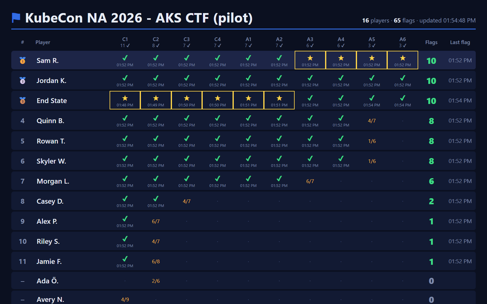
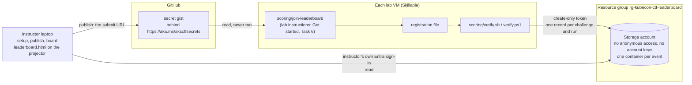

# Leaderboard – live scores for the lab room

An optional, projected leaderboard for the event. Attendees who join it (a command in the lab instructions) have the
result of each challenge that the lab repository's `scoring/verify.sh` or `./scoring/verify.ps1` checks recorded on a
central leaderboard; the instructor's laptop shows who has captured which flag, live, on the projector.

The scripts here create the leaderboard, open it to attendees, and show it. The code that lab VMs run to join and to
report is in the lab repository, which they have: [`scoring/join-leaderboard.ps1`](https://github.com/bbenz/kubecon26-pre-day-lab/blob/main/scoring/join-leaderboard.ps1),
[`scoring/lib/Leaderboard.ps1`](https://github.com/bbenz/kubecon26-pre-day-lab/blob/main/scoring/lib/Leaderboard.ps1),
and their bash versions.
Run the commands below from this repository's root, with a clone of the lab repository next to it (see the
[README](../README.md#set-up-clone-both-repositories-side-by-side)).





No server or app runs anywhere: the verify scripts write small records straight to Azure Blob Storage, and the board
is a static page the instructor opens locally. Attendees get the create-only token by joining: a command in the lab
instructions reads it from the event's registration link, https://aka.ms/aksctfsecrets, which points at a file in a
secret gist. A new token is a new version of that file, so the lab profile, its life cycle actions, and the lab
instructions never change for one.

## Security

The storage account is **not** an open blob: anonymous access and account keys are both disabled, it accepts HTTPS
(TLS 1.2+) only, and every request needs either a scoped, expiring token signed with Microsoft Entra ID or an Entra
sign-in.

| Who | How they get in | Can | Can't |
|---|---|---|---|
| Lab VMs (attendees) | A **create-only** token (user delegation SAS) for one container, valid for at most 7 days, HTTPS only; optionally locked to the lab provider's outbound IPs (`-AllowedIp` / `--ip`). They get it when they join, from the registration link. | add a result record | read, list, overwrite or delete anything |
| Instructor laptop | The instructor's own Entra sign-in (`az login`, Storage Blob Data Reader or Contributor on the account) | read the results | – no read token exists at all |

* **Kill switch:** `./leaderboard/cleanup.ps1 -RevokeOnly` (or `cleanup.sh --revoke-only`) invalidates every token at
  once (it took 16 seconds to take effect in testing), and closes the registration link; tokens also expire on their
  own.
* **Retention:** a lifecycle rule deletes every record 14 days (`-RetentionDays`) after it was written; delete the whole
  leaderboard after the event with `cleanup`.
* **Data stored:** a player ID (the Skillable user ID – an opaque number), the name shown on the board (first name and
  last initial – no e-mail address), the challenge, pass/fail and the number of checks passed.

Verified on Azure on 2026-11-03 with a token issued by `setup`: creating a record → 201; overwriting, reading,
listing and deleting with the token → 403; anonymous requests → 409 `PublicAccessNotPermitted`; the account key →
rejected (key-based authentication not permitted); a token locked to another IP → 403; a revoked token → 403
`AuthenticationFailed`.

**Accepted risks** (fine for a lab whose leaderboard is deleted after the event):

* The token is visible on the attendee's VM, and to anyone who has the registration link while the leaderboard is
  open: an aka.ms link is public, and a secret gist is only left out of search. Someone could post fake results, junk,
  or an offensive name to the projected board. The board only shows names as plain text (letters, digits, spaces,
  `. ' -`, 24 characters), the instructor can hide or delete players (see *During the event*), and you can
  spot-check the top finishers with `scoring/verify` before handing out prizes. Close the link after the event:
  `cleanup` does.
* Names on a projector are personal data – tell attendees in the lab introduction that the leaderboard shows their
  first name and last initial, that joining is optional, and that `--no-report` / `-NoReport` keeps a run off the
  board.
* The token must never be committed, here or in the public lab repository. `setup` writes it to `.lab/` (ignored by
  git), and `publish` to the secret gist, nowhere else. The registration file in the gist is data that the join
  script validates (an Azure Storage address with a create-only token that hasn't expired), never code that it runs.
* If your organization's policy disables public network access on storage accounts, lab VMs outside your network can't
  reach it; the alternative is a small API with a managed identity in front of private storage (not built).

There is no Terraform variant: the token is signed with your Entra ID by the Azure CLI, which Terraform can't do.

## Before the event

### 1. Create the leaderboard and a token (organizer, ~2 minutes)

```powershell
./leaderboard/setup.ps1 -Container kubecon-na-2026 -TokenHours 48
```

```bash
./leaderboard/setup.sh --container kubecon-na-2026 --hours 48
```

| Option (PowerShell / bash) | Default | |
|---|---|---|
| `-ResourceGroup` / `-g` | `rg-kubecon-ctf-leaderboard` | its own resource group (deleted by `cleanup`) |
| `-Location` / `-l` | `westus3` | |
| `-StorageAccount` / `--account` | `ctflb` + 8 hex characters from subscription and resource group | globally unique |
| `-Container` / `--container` | `ctf` | one container per event or pilot |
| `-TokenHours` / `--hours` | `48` | 1–168: issue the token the day before the event |
| `-AllowedIp` / `--ip` | – | only accept submissions from this IP or range (ask Skillable for their outbound IPs) |
| `-RetentionDays` / `--retention-days` | `14` | records are deleted automatically after this |

The script enforces the security settings, gives you Storage Blob Data Contributor on the account, creates the
container, issues the token and **tests it** (it must be able to record an entry and must not be able to read one). It
writes `.lab/leaderboard/` (ignored by git): `settings.env`, `submit-url.txt` and two Skillable life cycle actions
with the token filled in (an alternative to step 2). Re-running it is safe and issues a fresh token: publish it again
(step 2).

`setup` creates the leaderboard in the Azure CLI's current subscription and records it in `settings.env`; `board`
and `cleanup` then use that recorded subscription, whichever subscription is current later (override with
`-Subscription` / `--subscription`). Running `setup` with a different current subscription creates a new
leaderboard there and replaces the local files of the old one.

### 2. Open it to attendees (organizer, ~1 minute)

```powershell
./leaderboard/publish.ps1
```

```bash
./leaderboard/publish.sh
```

`publish` writes the submit URL from `setup` to one file in a **secret gist** in your GitHub account (the GitHub CLI,
`gh auth login`, with the gist scope), and checks that the event's registration link, https://aka.ms/aksctfsecrets,
serves it. Attendees join from the lab instructions (**Get started**, Task 6), with a command that runs the lab
repository's `scoring/join-leaderboard.ps1` on their VM:

```text
C:\LabFiles\kubecon26-pre-day-lab\scoring\join-leaderboard.ps1 -PlayerId "@lab.User.Id" -FirstName "@lab.User.FirstName" -LastName "@lab.User.LastName"
```

Skillable fills in the attendee's user ID and name when it shows the instructions, after it assigns the lab, so the
names are right with running preinstances too. The script reads the registration file (never runs it), accepts only an
Azure Storage address with a create-only token that hasn't expired, tests it with one write to `health/` (which the
board ignores), and writes `~/.kubecon-ctf/leaderboard.env`. A new token needs no change to the lab profile, its life
cycle actions, or the lab instructions: run `setup`, then `publish`.

* **The first time**, `publish` creates the secret gist, records it in `.lab/leaderboard/gist.env` (no token in it),
  and says that the link isn't set up yet. In the aka.ms portal, point https://aka.ms/aksctfsecrets at the file's
  address that it prints, `https://gist.githubusercontent.com/<you>/<gist ID>/raw/kubecon-ctf-leaderboard.env`, and run
  `publish` again: it checks the link. Later runs update the same gist, so the link never changes. On another laptop,
  pass `-Gist` / `--gist` with the gist's ID.
* **GitHub caches** a gist's file for up to 5 minutes. The join script and `publish` read the newest version, which
  GitHub serves within seconds of a change, and `publish` waits until the link serves it (`-WaitMinutes` /
  `--wait`, default 3).
* **Options:** `-Close` / `--close` publishes "no leaderboard is open" (`cleanup` does too); `-Link` / `--link` checks
  another registration link. The join scripts take `-From` / `--from` for another link, and the lab instructions use
  the default.

| What attendees see when they join | Why |
|---|---|
| `Joined the leaderboard as 'Brian B.'` | Registered: the next check without `-Quick` records their result |
| `The leaderboard's registration link, https://aka.ms/aksctfsecrets, isn't set up yet` | aka.ms has no target for the link: it sends unknown links to a Bing search page |
| `No leaderboard is open right now` | The gist says so: `publish -Close`, or `cleanup` |
| `The leaderboard didn't accept a test entry (HTTP 403 ...)` | The token was revoked (the kill switch: run `setup` and `publish`), or `-AllowedIp` doesn't include the VM's address |
| `The leaderboard's token expired at ...` | Run `setup` and `publish` |

Lab VMs need outbound HTTPS to `aka.ms`, `gist.githubusercontent.com`, and `<account>.blob.core.windows.net`, and
`curl` for `verify.sh` – no Azure role, no Azure CLI and no sign-in.

#### Alternative: a Skillable life cycle action

Only for a lab profile that you can change before the event (an LCA with the token must be pasted again after each
`setup`): in the lab profile, **Life Cycle Actions → Add**

* Event **First Displayable**, action **Execute Script in Virtual Machine**, language **PowerShell** (Windows VM) or
  **Bash** (Linux VM), **Blocking: No**, **Error action: Ignore** – the lab works without the leaderboard. (Skillable
  runs scripts in a VM only at First Displayable, Saving, Resumed, and Tearing Down.)
* Script: the contents of `.lab/leaderboard/skillable-lca-windows.ps1` (or `skillable-lca-linux.sh`) – not the
  templates in `leaderboard/skillable/`, which don't contain the token.

When a lab starts, Skillable replaces `@lab.User.Id`, `@lab.User.FirstName` and `@lab.User.LastName`, and the script
writes `%ProgramData%\kubecon-ctf\leaderboard.env` (Linux: `/etc/kubecon-ctf/leaderboard.env`) for every attendee,
without asking them. **With running preinstances, the names can be wrong:** First Displayable runs when Skillable builds
the preinstance, before it's assigned to an attendee. The join command doesn't have that problem.

The Skillable user ID keeps a player's flags when they relaunch the lab and join again; use `@lab.LabInstance.GlobalId`
instead if attendees share a Skillable account. In the Skillable pilot, check one attendee whose name has accents.

### 3. Prepare the instructor laptop

The Azure CLI and `az login` with **Storage Blob Data Reader** (or Contributor) on the storage account. Whoever ran
`setup` already has Contributor; to add another instructor:

```bash
az role assignment create --role "Storage Blob Data Reader" --assignee <user@contoso.com> \
  --scope $(az storage account show -n <account> -g rg-kubecon-ctf-leaderboard --query id -o tsv)
```

On a laptop that didn't run `setup`, pass `-StorageAccount`/`-Container` (`--account`/`--container`) to the board,
and `-Subscription` (`--subscription`) if that laptop's current Azure CLI subscription is in another tenant.

### 4. Rehearse

```powershell
../kubecon26-pre-day-lab/scoring/join-leaderboard.ps1 -Name 'Test T.'   # as an attendee, through the registration link
./tests/leaderboard/simulate-players.ps1 -Players 15      # demo players through the same reporting code and token
./leaderboard/board.ps1
az storage blob delete-batch --account-name <account> --source <container> --pattern 'results/demo-*' --auth-mode login
../kubecon26-pre-day-lab/scoring/join-leaderboard.ps1 -Remove
```

In a test launch of the lab profile, run the join command from the lab instructions (**Get started**, Task 6), and
check the name that it shows.

## During the event

```powershell
./leaderboard/board.ps1 -Challenges c1,c2,a2,c4 -Title 'KubeCon NA 2026 - AKS Capture the Flag' -Start '2026-11-10 09:00'
```

```bash
./leaderboard/board.sh --challenges c1,c2,a2,c4 --title 'KubeCon NA 2026 - AKS Capture the Flag' --start 2026-11-10T09:00
```

The script reads the results every 10 seconds (`-RefreshSeconds` / `--refresh`) and opens the page; press **F11** for
full screen. `-Challenges` sets the columns and what counts (default: all ten), `-Start` shows capture times as time
since the start, `-MaxRows` / `--max-rows` the number of players shown (default 20). If the script stops or can't read
the results, the page says so.

**Scoring.** A flag is captured the first time `verify` passes a challenge – a later failing run doesn't take it away.
Players rank by flags, then by who reached that number first (server time). ★ marks the first player to capture each
challenge; an amber `6/9` shows the latest check result for a challenge not captured yet. Runs with `--quick` / `-Quick`
or `--no-report` / `-NoReport` are not recorded.

**What attendees see** in the verify output:

```text
Leaderboard: recording results for 'Brian B.' (--no-report to skip)
  >> leaderboard: flag recorded for Brian B.
  >> leaderboard: progress recorded for Brian B. (6/9 checks)
  >> leaderboard: not recorded (HTTP 403 AuthenticationFailed) - your result above still stands; tell a proctor if this keeps happening
```

**Moderation.** Double-click a player to hide them on this screen (U shows hidden players again). To remove a player's
records for good (hover over a name to see the player ID):

```bash
az storage blob delete-batch --account-name <account> --source <container> --pattern 'results/<player-id>/*' --auth-mode login
```

**Kill switch.** `./leaderboard/cleanup.ps1 -RevokeOnly` (or `./leaderboard/cleanup.sh --revoke-only`) stops all
submissions within a minute (16 seconds in testing), and closes the registration link, so new joins are told that no
leaderboard is open; the board keeps showing what is there. To accept results again, run `setup` and `publish`, and
ask attendees to run the join command from **Get started**, Task 6 again: their registration has the revoked token.

## After the event

```powershell
./leaderboard/cleanup.ps1          # revokes the tokens, closes the registration link, deletes the resource group and the local files (asks first)
```

```bash
./leaderboard/cleanup.sh
```

`cleanup` only deletes a resource group that `setup` created (tag `purpose=kubecon-ctf-leaderboard`), in the
subscription recorded in `settings.env`. If it can't check the resource group (for example a sign-in problem), it
stops without deleting anything, including the local files. It keeps `.lab/leaderboard/gist.env` (no token in it),
so the next event's `publish` updates the same gist, behind the same link.

## Trying it outside Skillable

Register your own machine (it gets a random player ID), run a check from the lab repository, and leave again. The
lab repository's `scoring/join-leaderboard.ps1` (or `.sh`) does what attendees do, through the registration link;
`join` here reads the submit URL from `.lab/leaderboard/submit-url.txt` instead, with no link or gist needed:

```powershell
./leaderboard/join.ps1 -Name 'Brian B.'                  # uses .lab/leaderboard/submit-url.txt; or -SubmitUrl '<url>'
../kubecon26-pre-day-lab/scoring/verify.ps1 -Challenges c1
./leaderboard/join.ps1 -Remove
```

```bash
./leaderboard/join.sh --name "Brian B."                  # or --url '<url>'
../kubecon26-pre-day-lab/scoring/verify.sh --challenges c1
./leaderboard/join.sh --remove
```

For a single run, set `CTF_LEADERBOARD_URL`, `CTF_PLAYER_ID` and `CTF_PLAYER_NAME` instead.

## Reference

**Registration lookup** (first match wins): the environment variables above → the file in `CTF_LEADERBOARD_CONFIG` →
`~/.kubecon-ctf/leaderboard.env` (`join`, and the lab repository's `join-leaderboard`) →
`%ProgramData%\kubecon-ctf\leaderboard.env` or `/etc/kubecon-ctf/leaderboard.env` (the life cycle action). The file
is `KEY=value` lines (`CTF_LEADERBOARD_URL`, `CTF_PLAYER_ID`, `CTF_PLAYER_NAME`); it is parsed, never executed.
Machines without a registration don't report anything.

**Records.** One block blob per challenge and run: `results/<player-id>/<challenge>/<UTC time>-<random>.json`, with
the display name (base64), `passed` and `checks` as blob metadata and the same details as JSON in the body. The board
uses only the blob name, metadata and the server's creation time, so client clocks don't matter and record contents
are never rendered. `setup` and each join also write a `health/` probe that the board ignores.

| File | Purpose |
|---|---|
| `setup.ps1` / `setup.sh` | create or refresh the leaderboard, issue and test a token |
| `publish.ps1` / `publish.sh` | open the leaderboard to attendees: the submit URL in the secret gist behind the registration link, and a check of the link; `-Close` / `--close` |
| `board.ps1` / `board.sh` | read the results (Entra sign-in) and keep the projector page up to date |
| `leaderboard.html` | the projector page (static, no external resources) |
| `cleanup.ps1` / `cleanup.sh` | kill switch (`-RevokeOnly`) and deletion; both close the registration link |
| `join.ps1` / `join.sh` | register a machine with the submit URL from `setup`, without the registration link |
| `skillable/lca-windows.ps1`, `skillable/lca-linux.sh` | life cycle action templates (setup fills in the token): the alternative to `publish` |
| [`scoring/join-leaderboard.ps1`](https://github.com/bbenz/kubecon26-pre-day-lab/blob/main/scoring/join-leaderboard.ps1), [`scoring/join-leaderboard.sh`](https://github.com/bbenz/kubecon26-pre-day-lab/blob/main/scoring/join-leaderboard.sh) (lab repository) | what attendees run to join, from the lab instructions: reads the registration link |
| [`scoring/lib/Leaderboard.ps1`](https://github.com/bbenz/kubecon26-pre-day-lab/blob/main/scoring/lib/Leaderboard.ps1), [`scoring/lib/leaderboard.sh`](https://github.com/bbenz/kubecon26-pre-day-lab/blob/main/scoring/lib/leaderboard.sh) (lab repository) | reporting code used by the verify scripts |
| [`../tests/leaderboard/simulate-players.ps1`](../tests/leaderboard/simulate-players.ps1) | demo players for a rehearsal, through the lab repository's reporting code (`-LabRepo`) |
